# Sonoma Raceway 3D

A real-scale 3D model of Sonoma Raceway (Sonoma, California): the 12-turn, 4.06 km (2.52 mi) road course with its alternate layouts, pit lane, drag strip, paddock, grandstands and the surrounding hills. It was generated with the [Mint](https://mint.gg) Modeler from OpenStreetMap layout and real elevation data, then the junctions between roads were repaired locally.

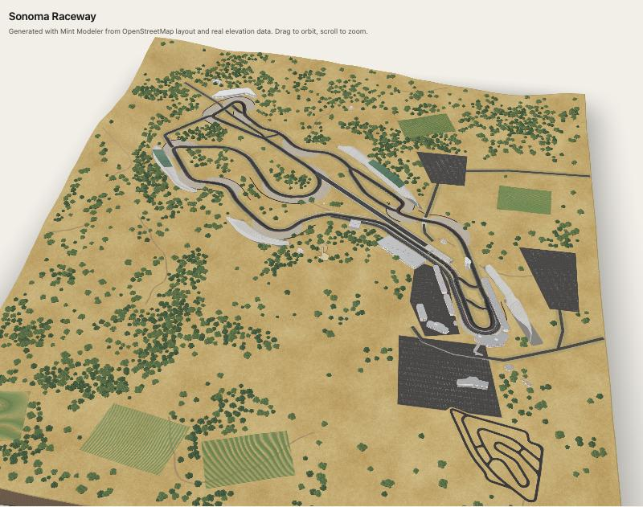

| Start / finish | The climb to Turn 2 | Turn 3a summit |
| --- | --- | --- |
| 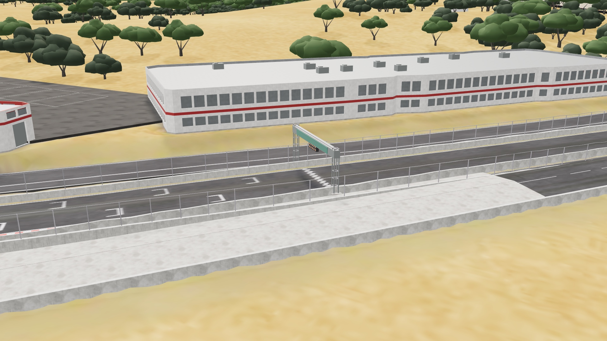 | 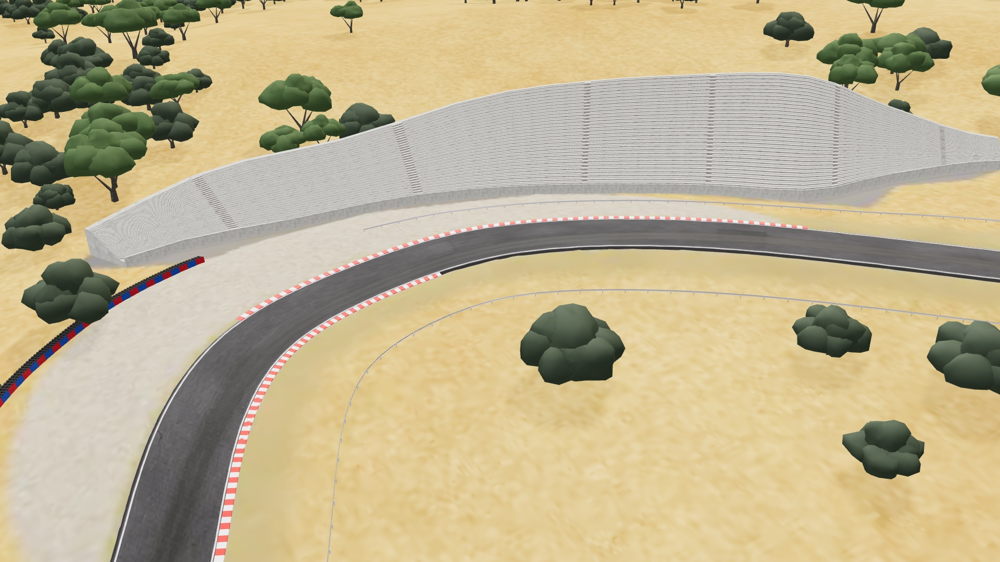 | 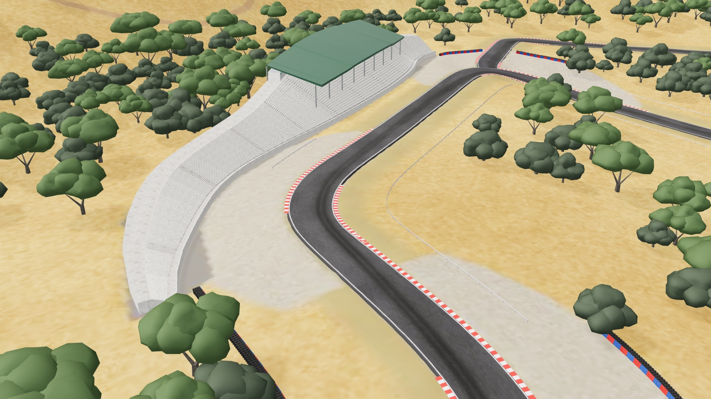 |
| **Carousel (Turns 4–6)** | **Turn 7 hairpin** | **Turn 11 hairpin** |
| 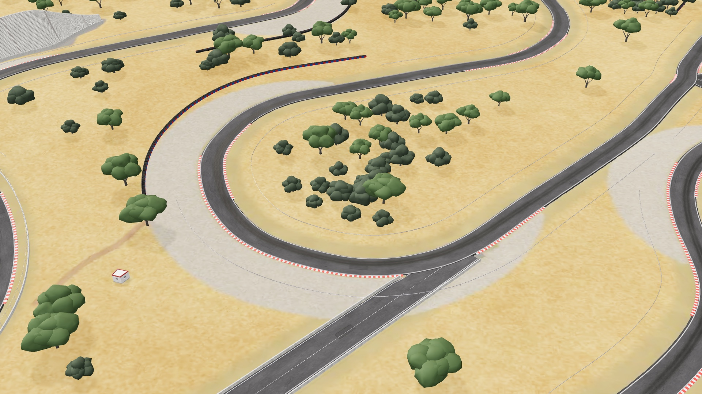 | 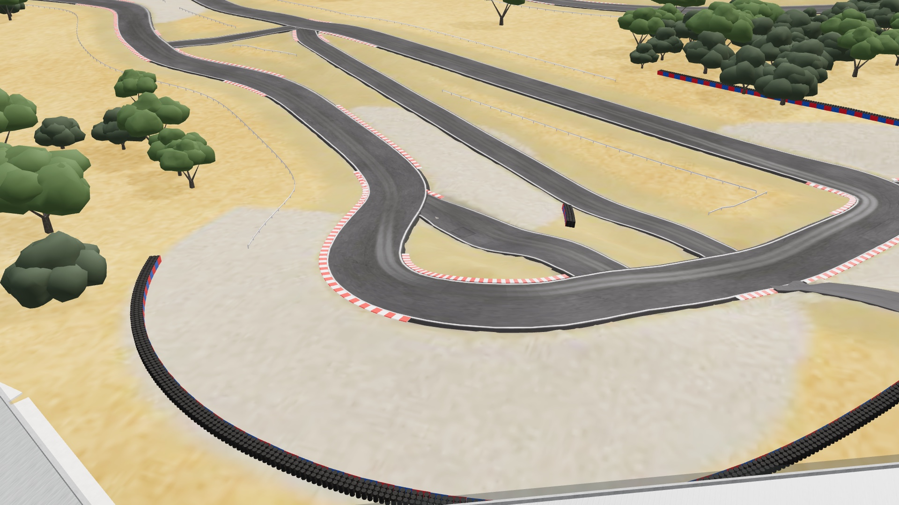 | 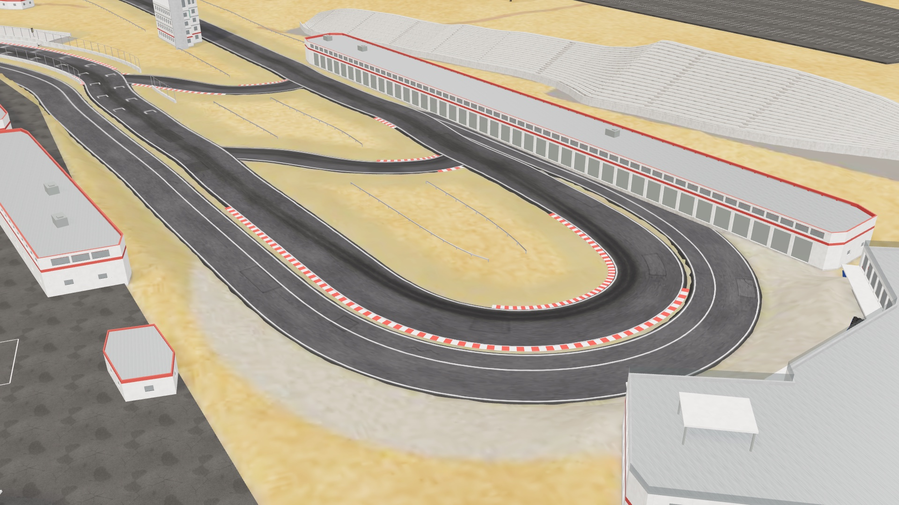 |

| Plan view | Across the hillside |
| --- | --- |
| 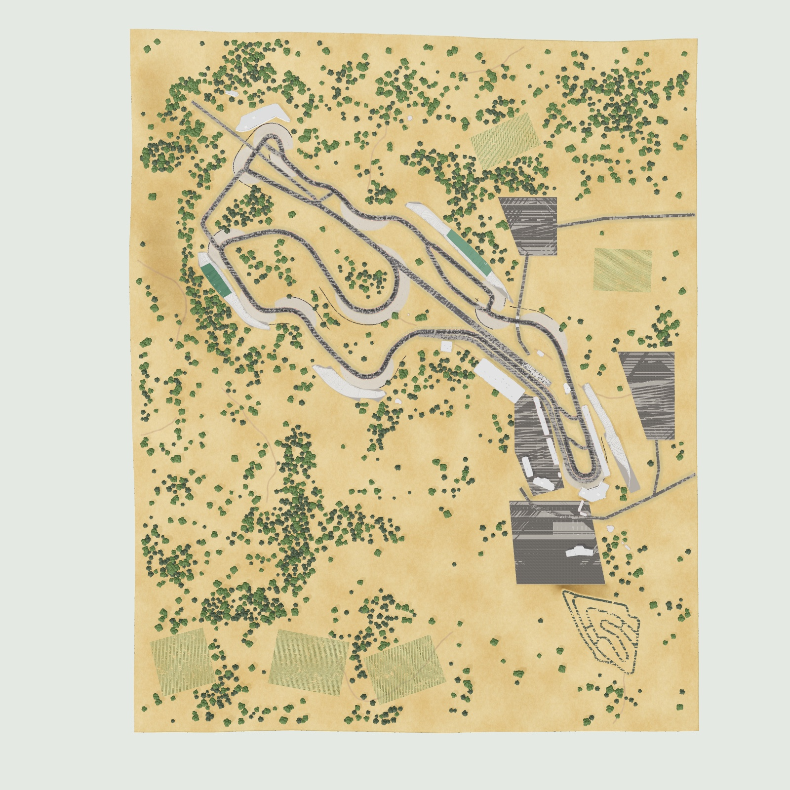 | 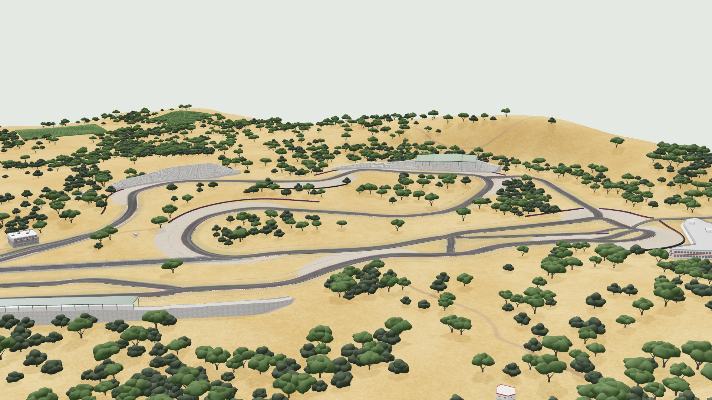 |

## View it

The repo is a static site. `index.html` is an interactive three.js viewer with orbit controls, shadows and one-click views of the main corners.

```sh
python3 -m http.server 8000
# then open http://localhost:8000
```

To publish it, turn on GitHub Pages for this repository (Settings → Pages → Deploy from branch → `main`, folder `/ (root)`). It will then be live at `https://wrydhan.github.io/SonomaGuide/` with no build step.

## Drive it

Open [`racing/`](racing/) for a first-person time trial in the Porsche 911 GT3 RS Manthey or blue open-top car, or click **Drive the circuit** in the viewer. Use W/A/S/D or arrow keys to drive, Space to brake, R to recover (+5 seconds), C for the chase camera, and Escape to pause. Touch controls are available on phones. Choose your car in the menu. Complete the ordered checkpoints to record a lap and a separate best time for each car on this device.

This is an arcade driving mode with sampled elevation, crossfall, runoff and roadside limits. It uses the same repaired track; the model's known visual issues remain. See the [driving guide](racing/README.md) and [verification evidence](reference/racing-review/README.md).

## The model

| File | What it is |
| --- | --- |
| `sonoma-raceway.glb` | Full-quality model: 41.8 MB, about 800k unique triangles (3.0 million drawn, with instanced trees and tyre stacks), 209 named meshes, 32 PBR materials with 4K road and terrain atlases |
| `sonoma-raceway-web.glb` | Web copy used by the viewer: 12.4 MB, the same geometry with meshopt compression and WebP textures |

- Real-world scale in metres, glTF Y-up. The base is 1.52 × 1.87 km: the whole site plus a 150 m margin.
- The layout follows OpenStreetMap: road course, NASCAR/IndyCar/motorcycle variants, pit lane, drag strip, paddock, karting circuit and parking. The terrain follows the real 4–55 m elevation range: the low front straight, the climb through Turns 1–2, the summit at Turn 3a, the descending Carousel and the Turn 11 hairpin.
- Mesh names describe the parts (`road_main`, `road_alt_*`, `road_pit_lane`, `road_drag_strip`, `terrain`, `trackside_kerb_*`, `bar_*`, `grandstands_*`, `buildings_*`, `vegetation_*`).

## Junction repair

The Modeler output had defects at all 18 places where a branch road (alternate layout, pit lane, drag strip, access road) meets the main circuit: branch ends floating 2–5 m above or below the track as raised slabs or cliffs, unpaved wedges between road surfaces, and a duplicate road piece stacked on another. A Mint revision request (`revision-prompt.md`, with the measured evidence in `reference/revision-1/`) returned the model unchanged, so the junctions were repaired locally with `tools/fix_junctions.py`:

- Each branch end lands on the main track and tucks just under its surface, so the main asphalt and its edge line run across the mouth. Corners that fell short slide onto the track, closing the wedges.
- Height changes blend back along the branch over 25–90 m (8% grade at most), matching cross-fall across the road width.
- Terrain under a moved branch sits just below it and buries its sloped sides. Ground beside any road edge stays below that edge, and ground next to the main circuit keeps its height.
- Kerbs follow their own branch. Walls, guardrails, trees and tyre stacks re-ground on the new terrain. The drag strip's centre line stops at the main track edge.
- The duplicate `road_alt_t7_link` piece was removed. Nothing else changed: the main circuit, buildings, materials and UVs are untouched.

`tools/check_junctions.py` measures every road end. Seventeen of the 18 joined ends pass the current checker. The drag-strip join retains one corner 3.90 m outside the main-road surface while its other end vertices overlap at a 10 cm tuck; this remaining verge corner is listed below. Before the repair, all 18 failed. The repair then went through five rounds of adversarial visual review, with reviewers comparing before/after renders of each junction from two sides.

| | | |
| --- | --- | --- |
| 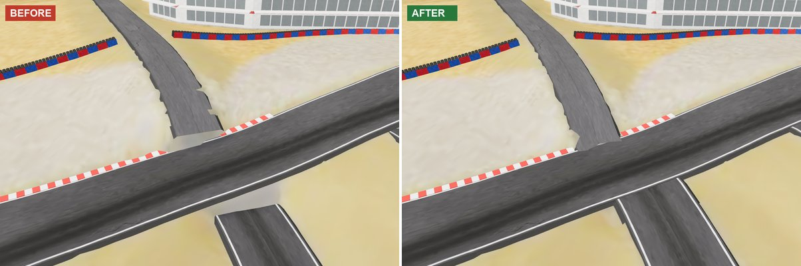 | 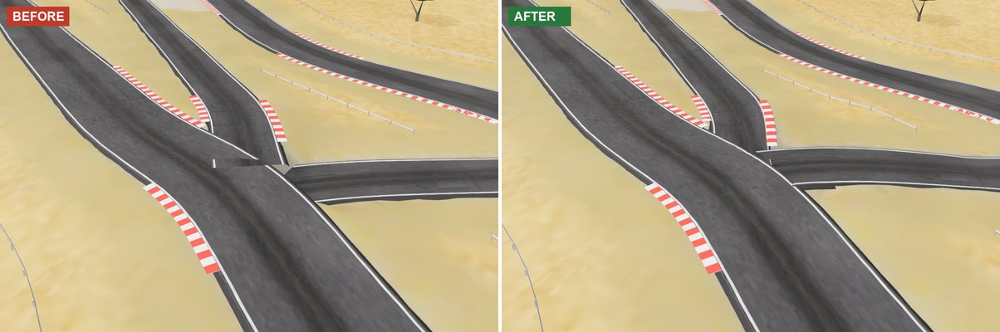 | 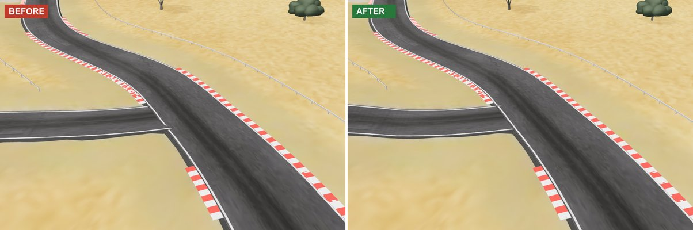 |
| 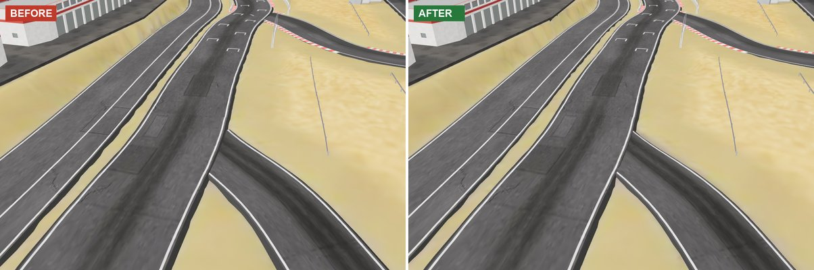 | 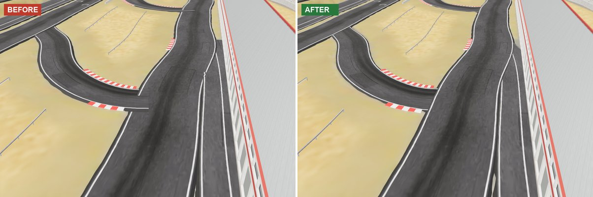 | 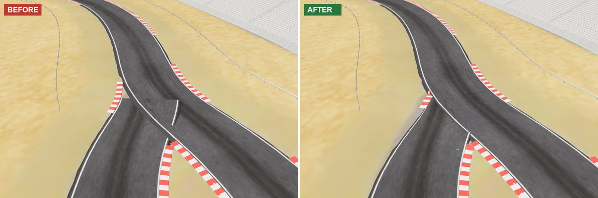 |
| 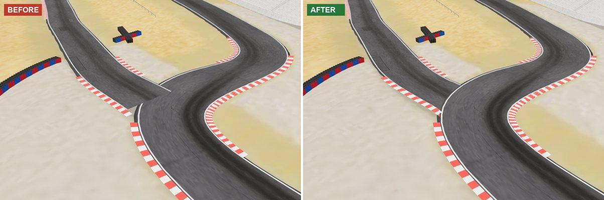 | 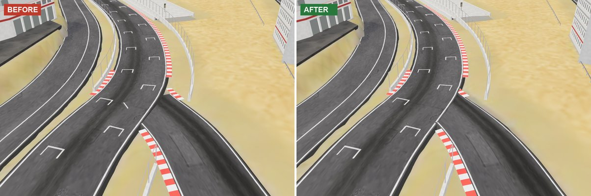 | 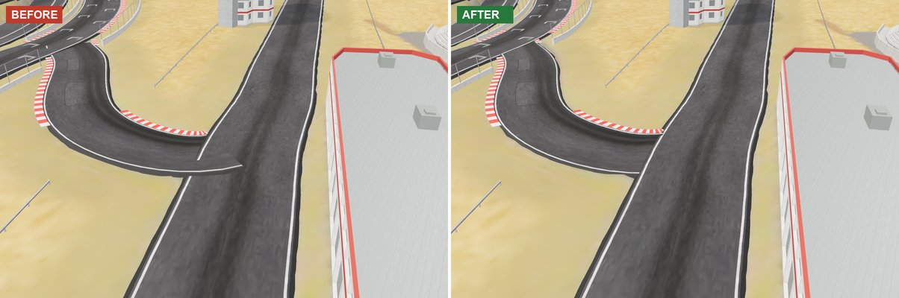 |
| 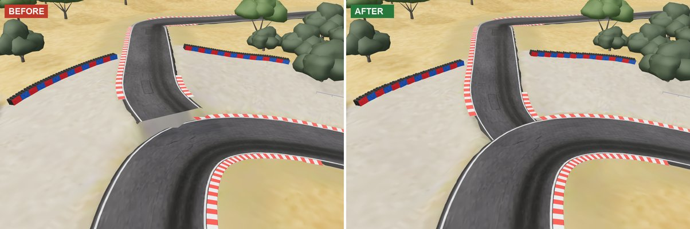 | 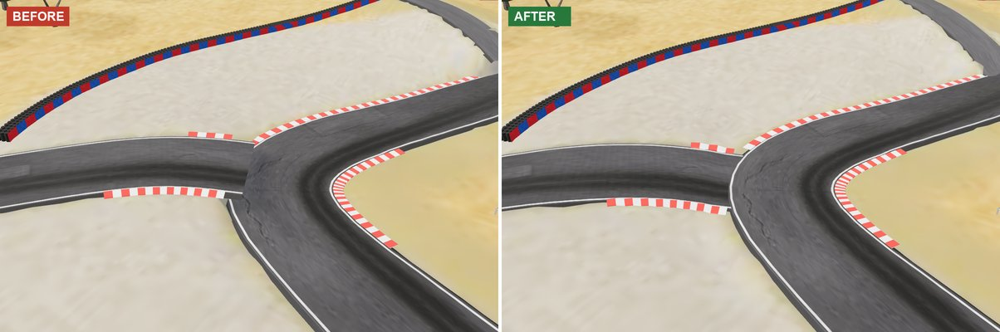 | 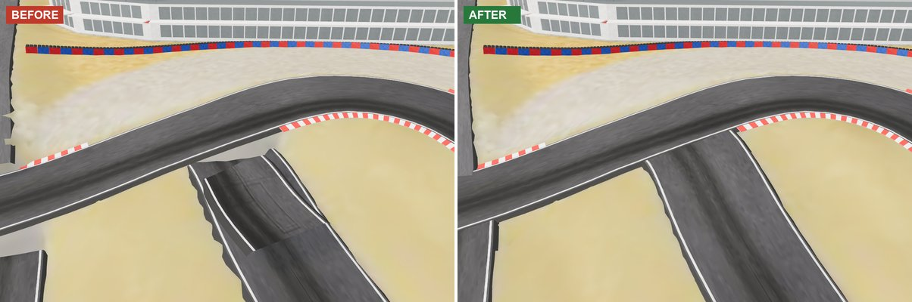 |
| 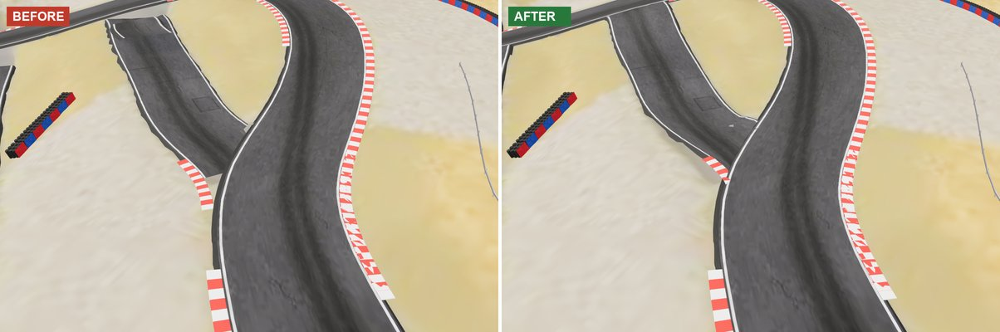 | 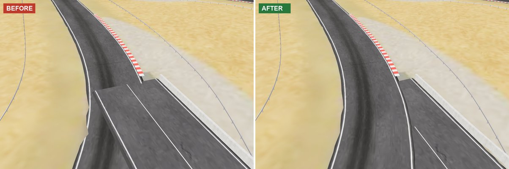 | 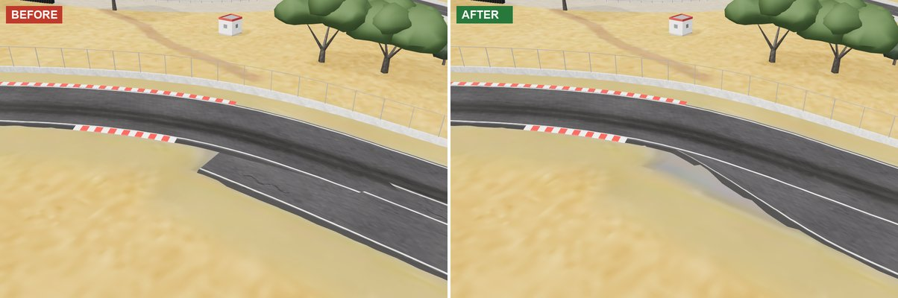 |
| 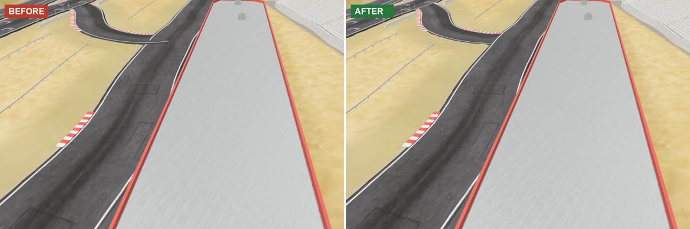 | | |

### Known remaining issues

The repair removed the large floating slabs, cliffs and stacked duplicate, and closed the branch-road wedge gaps except for the retained drag-strip verge corner. Review still finds smaller flaws, mostly from the model's coarse 3 m road and terrain meshes:

- Some branch roads still show a thin band of their grey sloped sides above the ground, with a slightly sawtoothed lower edge where the terrain meets them. Several roads elsewhere on the model look the same.
- The access road at the north-west crossing keeps the ragged edges it had in the original model, and it meets the main kerb with a slight lip.
- On a few short branches, the point where a height blend starts reads as a gentle crease rather than a perfectly smooth change of grade.
- Beside the pit-lane tapers, the newly graded embankment is steep enough to show a grey-blue shading patch, and the pit lane meets the main track's edge with small notches.
- The drag strip ends as a short slab on the verge beside the track, and a guardrail crosses it. Both come from the original model.
- A few guardrails and walls bend slightly where they re-ground on changed terrain.

## Second Mint revision

The second revision finished on October 21, 2026. It improved heights compared with the original but failed 17 of 18 joined-end checks, versus one flagged end in the published local repair. The current repaired models are retained. See the [review, measurements and 64-view comparison](reference/revision-2-review/README.md) for the results and limits of those checks.

## How it was made

1. `tools/build_reference.py` turns the OpenStreetMap extract (`data/osm-sonoma.json`) and Copernicus elevation samples into a top-down reference map coloured by height (`reference/reference-map.png`) and track centrelines (`reference/track-data.json`).
2. `tools/mint-modeler.mjs` sends the reference map and the brief (`prompt.md`) to the Mint Modeler at the Studio tier, polls the job and downloads the GLB. The same client also sends revisions (`--revise`).
3. `tools/fix_junctions.py` repairs the junctions in the GLB, `tools/check_junctions.py` measures them, and `gltf-transform prune` removes the dropped piece's unused data.
4. The web copy is made with `gltf-transform optimize sonoma-raceway.glb sonoma-raceway-web.glb --compress meshopt --texture-compress webp --texture-size 4096 --simplify false --instance false --join false --flatten false`.
5. The pictures are rendered from the viewer (`window.sonomaViewer` exposes the renderer and camera for scripted stills), and `tools/make_comparisons.py` builds the before/after sheets.

```sh
python3 tools/build_reference.py data/osm-sonoma.json reference         # needs matplotlib, numpy
MINT_API_KEY=... node tools/mint-modeler.mjs                             # resumable; state in build/
git show 78727be:sonoma-raceway.glb > build/original.glb                  # the unmodified Modeler output
python3 tools/fix_junctions.py build/original.glb build/fixed.glb build/fix-report.json   # needs numpy, scipy, trimesh
python3 tools/check_junctions.py sonoma-raceway.glb build/junctions
```

## Data sources

- Track and building geometry: © OpenStreetMap contributors, ODbL.
- Elevation: Open-Meteo elevation API (Copernicus DEM GLO-90).
- Corner names follow the circuit's official numbering.
