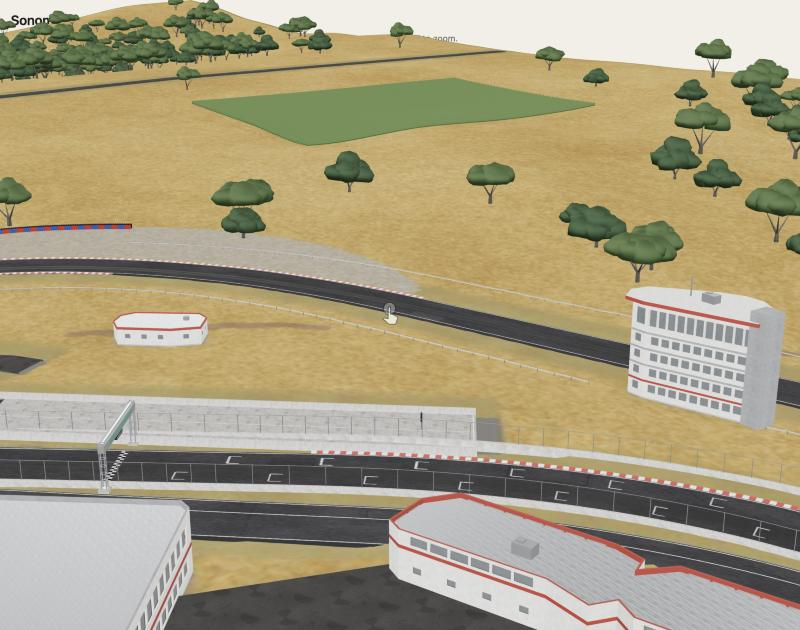
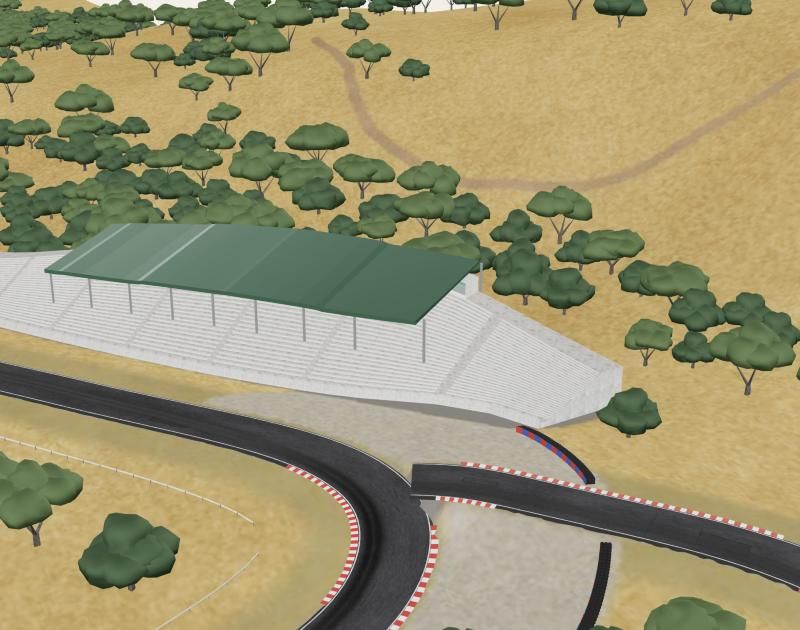

# Sonoma Raceway 3D

A studio-quality 3D model of Sonoma Raceway (Sonoma, California), generated with the [Mint](https://mint.gg) Modeler API from real map and elevation data.


| Front straight and timing tower | Hillside grandstand |
| --- | --- |
|  |  |

## The model

- `sonoma-raceway.glb`: 45 MB, about 800k triangles, 210 named meshes (road course, alternate layouts, pit lane, drag strip, terrain, kerbs, barriers, grandstands, buildings, trees, base) and 32 PBR materials.
- Real-world scale in metres. The base is 1.52 × 1.87 km: the full site plus a 150 m margin.
- The layout comes from OpenStreetMap, and the terrain follows the real 4–55 m elevation range: the low front straight, the climb to Turns 2–3a, the descending Carousel and the Turn 11 hairpin.
- Generated with Mint Modeler at the Studio quality tier (model `ks7bwq70wz3q6701trc8h3sthd8gpjkr`).
- Known flaw: there are small gaps and steps where some alternate-layout sections join the main circuit.

## Files

| Path | What it is |
| --- | --- |
| `sonoma-raceway.glb` | The delivered model (metres, glTF Y-up) |
| `index.html` | Viewer; serve the folder and open it in a browser |
| `renders/` | Viewer screenshots and Mint's own preview render |
| `prompt.md` | The modelling brief sent to Mint Modeler |
| `reference/reference-map.png` | Top-down layout with the track coloured by elevation, sent as the reference image |
| `reference/track-data.json` | Track centrelines (metres) with per-vertex elevation |
| `data/osm-sonoma.json` | Raw OpenStreetMap extract |
| `tools/build_reference.py` | Rebuilds the reference map and track data from the OSM extract |
| `tools/mint-modeler.mjs` | Uploads the reference, runs the Studio-tier generation, polls and downloads the GLB |

## View

```sh
python3 -m http.server 8000
# open http://localhost:8000
```

## Regenerate

```sh
python3 tools/build_reference.py data/osm-sonoma.json reference   # needs matplotlib + numpy
MINT_API_KEY=... node tools/mint-modeler.mjs
```

The client stores its idempotency keys and operation ID in `build/state.json`, so a rerun resumes the same operation. Delete that file to start a new paid generation.

## Data sources

- Track and building geometry: © OpenStreetMap contributors, ODbL.
- Elevation: Open-Meteo elevation API (Copernicus DEM GLO-90).
