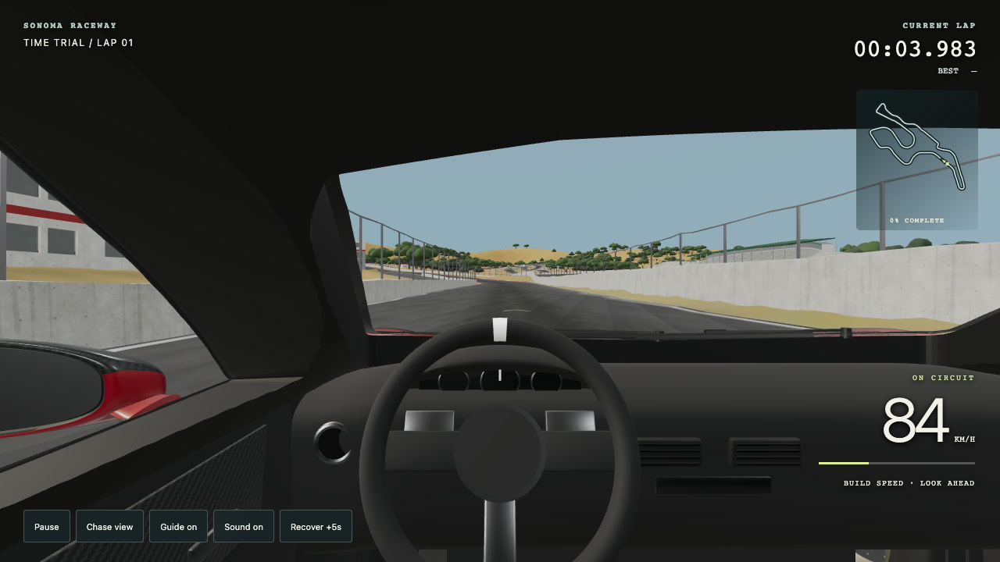
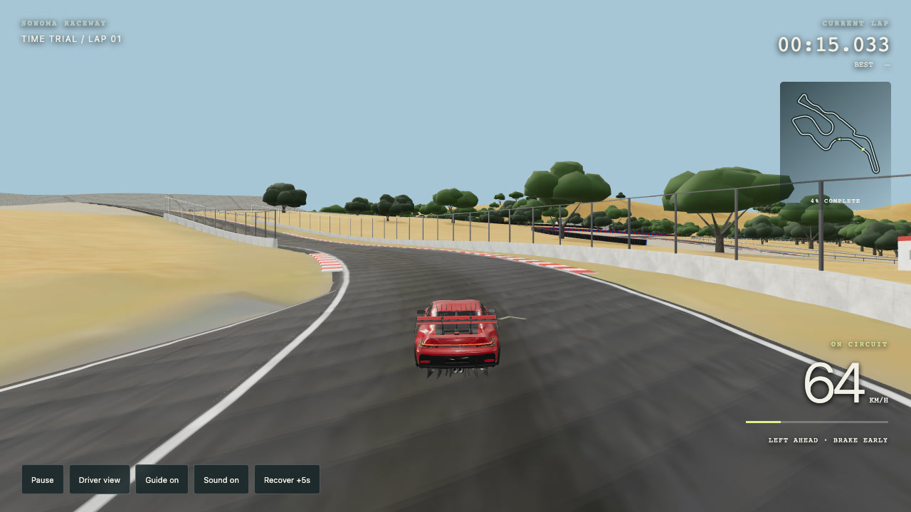
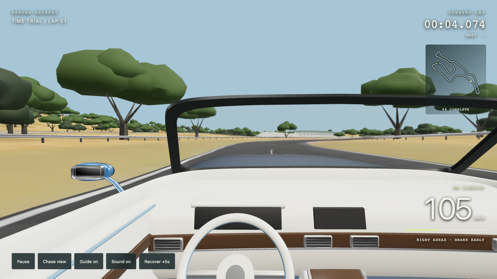
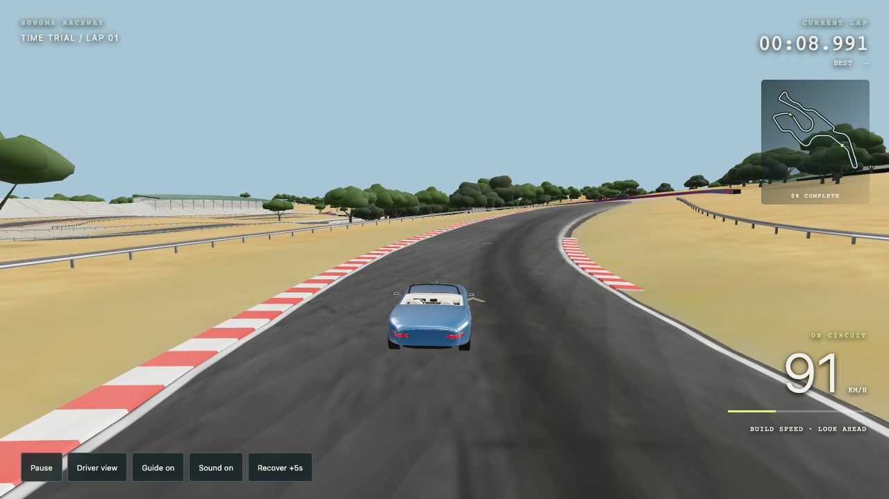

# Sonoma gameplay captures

Fresh captures from the running racing mode on October 23, 2026. Both cars are shown in cockpit and chase views. The screenshots come from active driving with the HUD visible.

[Watch the gameplay video](sonoma-gameplay.mp4) — 32 seconds, 1280×720, H.264, 30 fps, 8.6 MB. Silent capture.

| Porsche · cockpit | Porsche · chase |
| --- | --- |
|  |  |
| **Roadster · cockpit** | **Roadster · chase** |
|  |  |

## Capture notes

The video records actual Chrome/WebGL gameplay using scripted keyboard inputs. It is two joined segments, not a continuous lap: the first follows the Porsche from the start for 20 seconds; the second begins the blue roadster at route distance 1,100 m for 12 seconds. Each segment switches from cockpit to chase at its midpoint. No artificial cars, track shots or motion were generated for this video. Browser screencast timestamps set the frame durations; FFmpeg encodes H.264 with web playback metadata at the beginning of the file.

Neither captured segment hit the corridor boundaries, and no browser page/console errors or failed requests were recorded. The complete MP4 decoded without errors, and its resolution, codec and duration were checked with ffprobe. See `capture-report.json` and `video-check.json`. These captures demonstrate the existing arcade driving mode, not a completed lap or real-world vehicle physics.

## Handling revision clip

`sonoma-handling.mp4` is a 24-second, 1280×720, 30 fps silent capture of the October 28 steering revision. It shows the Tourbillon cockpit and chase view through the opening uphill bends. A conservative automated driver fed analog steering/pedals through the standard gamepad input path, with no position animation or speed-up. See `reference/steering-review/` for the run trace and verification. Older Porsche/roadster media above retains the earlier handling.
