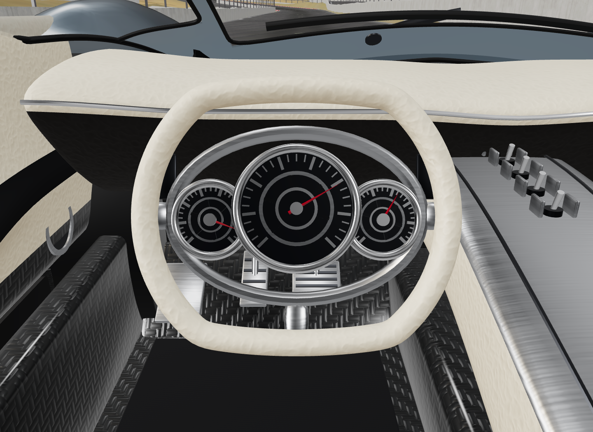
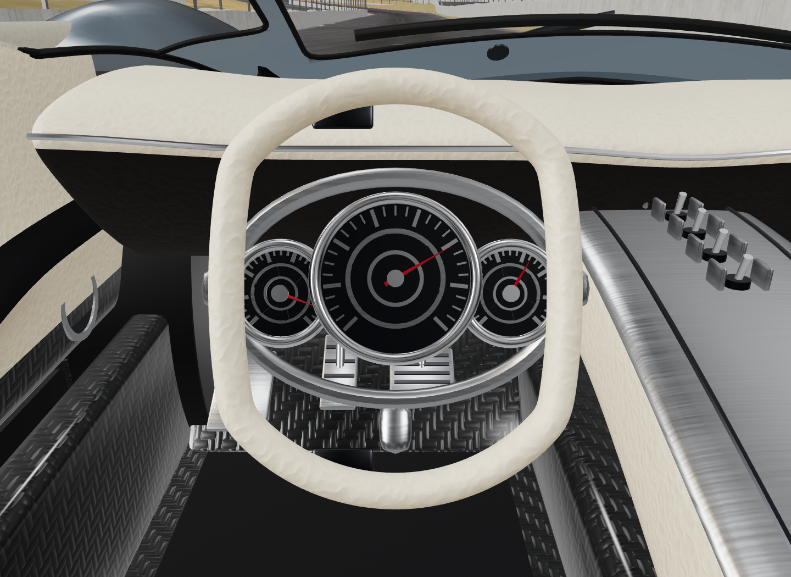
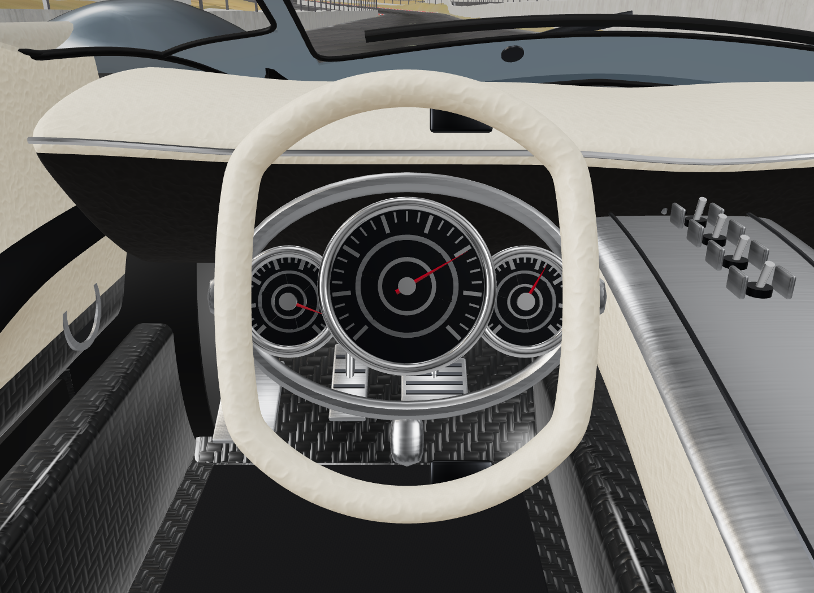

# Bugatti steering wheel rig repair

The previous rim rig used shaft direction `(0, +0.35, +0.937)`. The original wheel geometry is tilted +22° about X, so its shaft is `(0, -sin(22°), cos(22°))`. The opposite Y sign made the rim tilt out of its own plane and wobble toward the driver when turning.

`racing/steering-rig.js` places the rotor at the measured wheel centre `(0.335, 0.660, 0.450)` and uses the measured shaft direction. Attaching parts preserves their imported rest transforms. The leather rim and its two paddle fittings rotate together. The aluminium instrument ring, bearing supports, dials, needles and column stay fixed. [Bugatti describes the Tourbillon's fixed-hub arrangement here](https://newsroom.bugatti.com/press-releases/the-bugatti-tourbillon-an-automotive-icon-pour-leternite).

The source export combines paddles and gauge details into one material mesh. The adapter separates connected paddle components by topology and their measured outer-rim bounds, preserving original triangle indices, UVs, normals and materials. It targets this exact export, recorded in `racing/assets/bugatti-provenance.json`. The original GLB and driving physics are unchanged.

`node tests/bugatti-steering-rig.mjs` loads the actual exported steering geometry and sweeps −450° through +450°. It checks wheel centre, radius and plane invariance, stationary gauge anchors, both moving paddle components, and retention of all 21,978 source steering triangles. The largest measured drift is below 2e−15 m in this transform test. See `geometry-check.json`.

Chrome checks use actual A/D input, release-to-centre, camera switching, and Porsche → Bugatti reload. The visual rotor quaternion matches the physical steering state, and reloading produces one rotor without duplicates. Close-up renders hold physics fixed to inspect neutral and ±90° handwheel poses. They are inspection views; the normal cockpit camera is unchanged. See `browser.json` and the images below.

| Neutral | Left 90° | Right 90° |
| --- | --- | --- |
|  |  |  |

The earlier steering-review video predates this visual rig repair.
