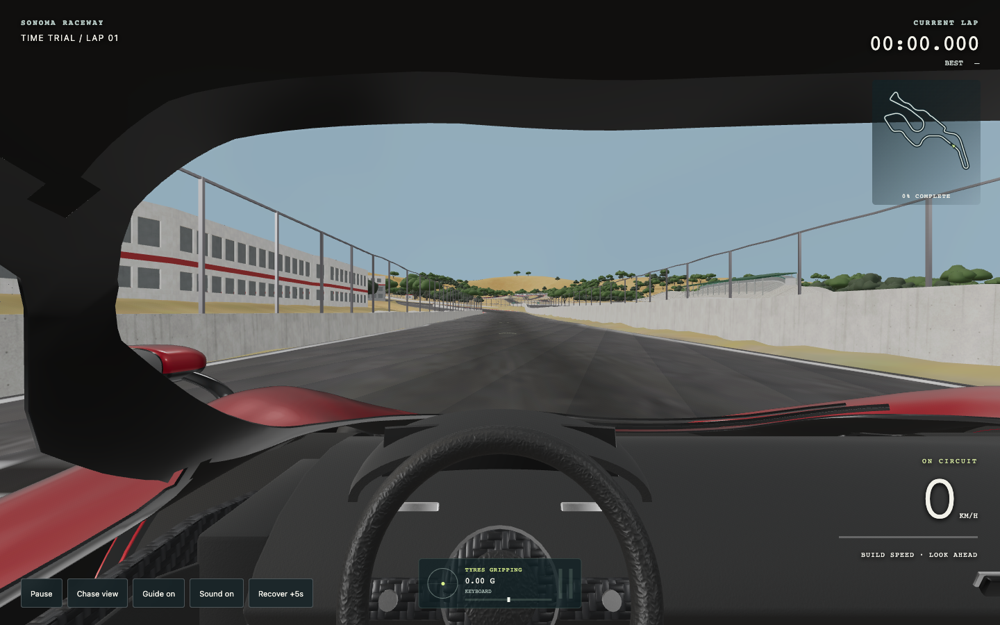
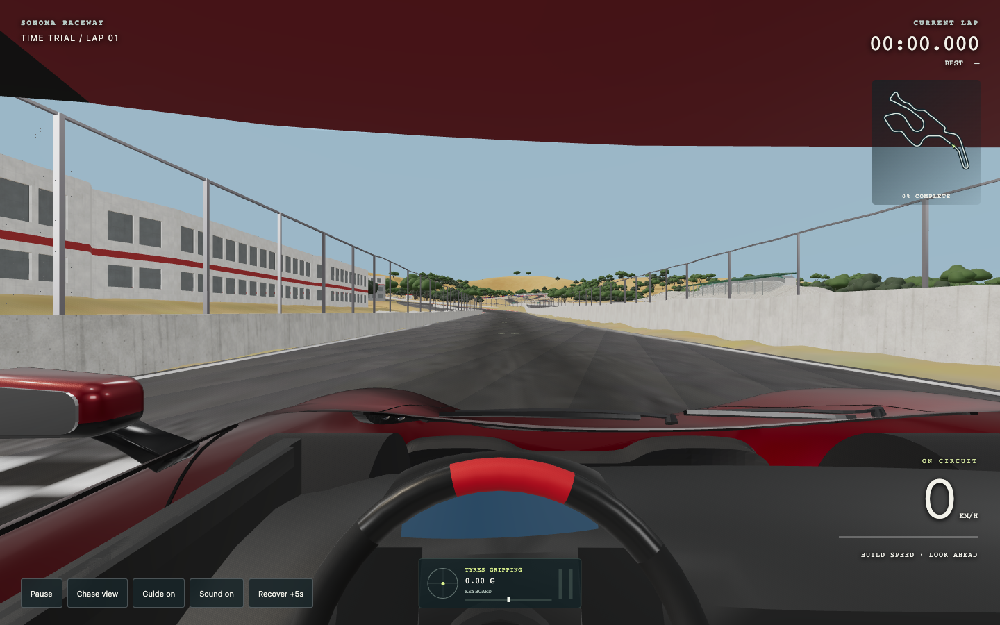
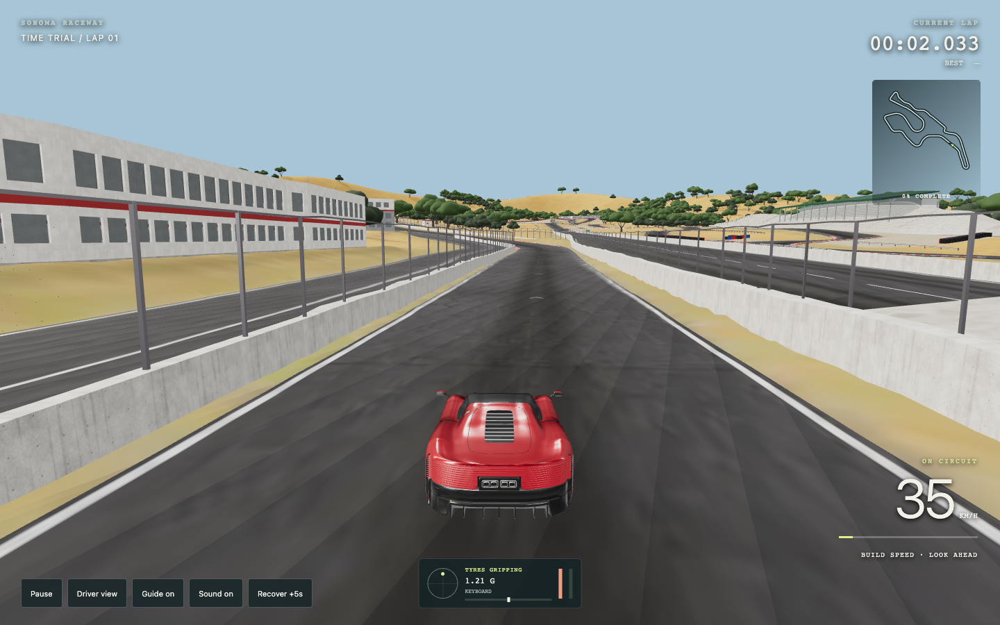
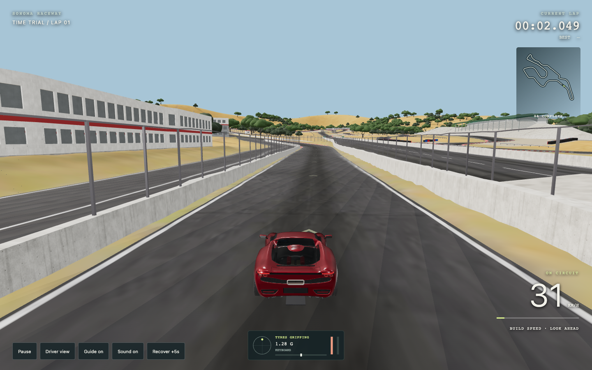

# Ferrari Daytona SP3 and 296 GTB

Both requested existing Modeler exports are selectable in the game:

- [Daytona SP3 source](https://mint.gg/share/ks737ajsbxzw7fpja9jtptxw7s8h4z8e): `?car=daytona`.
- [296 GTB source](https://mint.gg/share/ks75ntf5wf6ah86zvc74zymd698h4fqh): `?car=ferrari296`.

Original embedded GLBs are retained, with file size, SHA-256 and source IDs in adjacent provenance JSON files under `racing/assets/`. No new generations or conversions were started. Both models use metres, Y-up and +Z forward. Source approximate details and small geometry defects remain; integrating them does not certify their blueprint fidelity.

## Driving setup

Each car has a separate profile, chassis configuration and local best-time key. Both inherit the current tyre-force/yaw-inertia handling, smooth road, analog controls and driving feedback.

| Flat-road benchmark | Daytona SP3 | 296 GTB |
| --- | --- | --- |
| 0–100 km/h, measured in game | 2.85 s | 2.90 s |
| 0–200 km/h, measured in game | 7.40 s | 7.30 s |
| 200–0 km/h | 115.80 m, estimate | 107.00 m, calibrated |
| Game speed cap | 340 km/h | 330 km/h |
| Wheelbase | 2.651 m | 2.600 m |
| Front static weight share | 44% | 40.5% |

Sources: [Ferrari Daytona SP3 specification](https://www.ferrari.com/content/dam/ferrari-fcom/old/pdf/cs_ferrari_daytona_sp3_gbr.pdf), [Ferrari 296 GTB launch specification](https://cdn.ferrari.com/cms/network/media/pdf/CS_296_GTB_final_gbr.pdf). The game acceleration envelope matches the published standing-start targets. Manufacturer top speeds exceed the stated game caps; the caps are conservative gameplay choices. The 296 stopping-distance curve is fitted to one published 200–0 benchmark, not independent braking validation across speeds.

Running masses (1,650 / 1,600 kg), drag, higher-speed acceleration curves, brake/grip coefficients beyond the calibrated benchmark, steering ratio, yaw inertia and suspension-feel values are estimates. Published dry masses are not treated as loaded running masses. The existing simplified planar chassis and its limitations still apply; hybrid battery depletion and full drivetrain simulation are absent.

## Asset adapters

`vehicle-rig.js` combines the separate tyre/rim/disc meshes into rolling groups at their exported axle positions. Calipers follow steering without spinning. Actual front/rear mesh radii control rolling speed. Steering-wheel pivots follow the measured 22° shaft and centres: Daytona `(0.33, 0.70, 0.62)`, 296 `(0.36, 0.68, 0.38)`. Connected geometry partitions separate the rotating rim/hub/spokes from fixed columns and rear paddle fittings. Rest geometry, triangle totals, materials and UVs remain intact.

The driver views use each car's own seat/eye position, with reduced cabin-glass opacity while driving and normal opacity restored for chase view. Car switching resets the lap, as for existing cars.

## Checks

- `node tests/ferrari-assets.mjs`: real source geometry bounds/scale, no lost triangles or rest-pose movement, four wheel groups, stationary calipers during rolling, steering planarity and fixed columns, plus acceleration/braking calibration.
- `node tests/all-cars-lap.mjs`: all five cars complete ordered-checkpoint laps with no boundary contacts and under 2.5 m peak centreline deviation. These are conservative QA laps, not predicted lap times.
- `node tests/handling-dynamics.mjs`, `node tests/test-performance.mjs`, and `node tests/bugatti-steering-rig.mjs`: handling and previous calibration/rig regressions pass.
- Chrome: selector, acceleration, steering, braking, cockpit/chase, switching back to Bugatti, and landscape touch steering/release checked. These are desktop Chrome device emulations; physical phone GPU performance is not validated.

JSON measurements and captures accompany this review.

| Daytona SP3 cockpit | 296 GTB cockpit |
| --- | --- |
|  |  |
|  |  |
