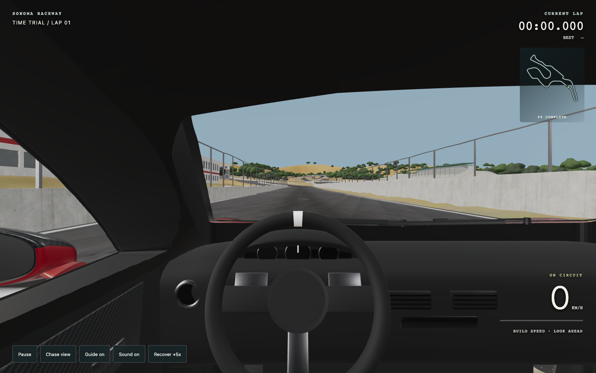
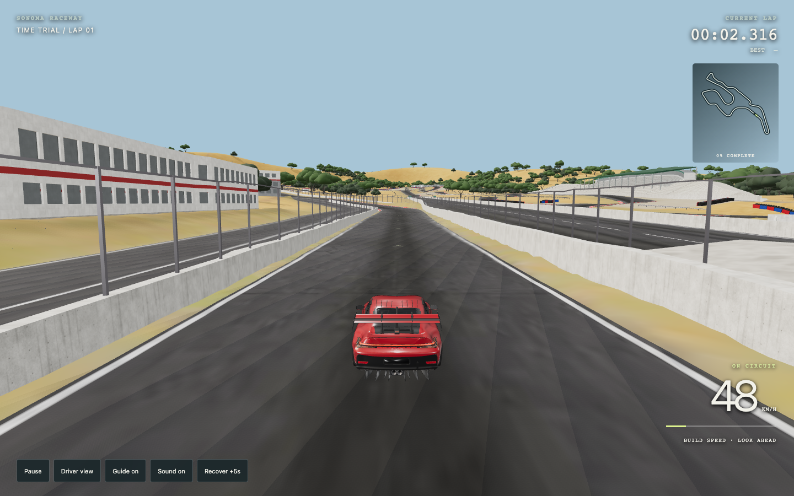
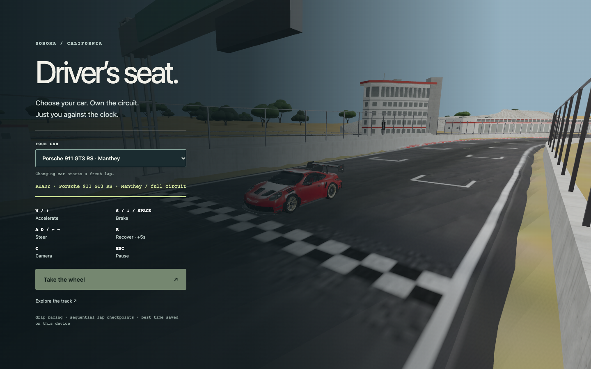
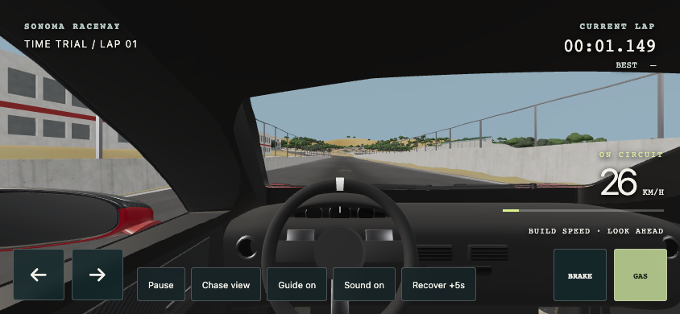

# Porsche selection update — October 23, 2026

Added the recent completed Modeler Porsche 911 GT3 RS (992) Manthey Kit as a second racing car. The selected asset is [available in Mint](https://mint.gg/0xe6658008c9104e1a98e1972a84a46443f3d7e1b3/ks767xpeda0gy5cfejnvaarq4d8gtj7a), completed October 23 at 18:12 UTC. It was retrieved from the existing model catalog and artifact manifest; no generation or paid conversion was started.

The original GLB is preserved at `racing/assets/porsche-manthey.glb` (24,396,116 bytes). Its file fingerprint and source metadata are in `porsche-provenance.json`. The full model has a cabin, separate steering assembly, Manthey aero and four named wheel pivots. A runtime Y rotation of pi converts its -Z forward convention to the game's +Z forward convention. Wheel spin direction and tire radius are configured per car.

The menu now has a car selector. Porsche is the default for a new device; the user's last selection is remembered. `?car=porsche` or `?car=roadster` explicitly opens either car. Changing cars starts a fresh lap and clears held input. Blue roadster best records retain their existing storage key; Porsche records use a separate key. Both cars retain the same arcade handling and track limits.

## Camera adapter

The Porsche's source `interior_shell` contains a panel that obstructs the windscreen from a normal driver eye position. First-person rendering hides that interior-shell node and reduces windscreen material opacity to 0.08; the other dashboard, steering, seat and cabin parts stay present. Chase view restores the complete interior shell and original glass opacity. The source GLB is unchanged. Driver eye is (+0.37, 1.02, -0.12) m in normalized car space. This is a camera presentation adjustment, not a claim that the source cabin geometry was rebuilt.

## Verification

- Static JavaScript syntax checks passed. The existing full-route simulation test passed, including a valid 24-gate lap, rejected out-of-order finish, recovery and boundary cases.
- Desktop Chrome at 1440×900 loaded the Porsche, rendered the cockpit and complete exterior, and accelerated under real W input. After two seconds the car reached about 13.4 m/s and moved about 14 m.
- Car switching Porsche → roadster → Porsche reset the current lap and retained working rendering and controls. Resources from the previous car are disposed on a successful replacement; the whole track is not reloaded.
- Separate seeded best times (123 s Porsche, 91 s roadster) remained separate across switching.
- An injected Porsche download failure preserved the working roadster and re-enabled Start. Retrying the Porsche load succeeded.
- Mobile Chrome emulation at 844×390 loaded the Porsche and drove with the touch pedal. Releasing the pedal cleared throttle. No page errors were recorded.
- The ordinary desktop run recorded no page/console errors or failed asset requests. The injected 404 was intentional and isolated to the failure-recovery check.
- Driver view reports about 582 draw calls and 2.51 million drawn triangles at the initial pose. These headless measurements describe functional rendering, not real-device FPS. No new performance guarantee is made.

Screenshots were inspected to catch and correct the obstructed initial camera. Browser checks are in `browser-check.json` and `selection-check.json`. Existing full-lap tests remain the gameplay regression check; no suspension or real-world Porsche handling is claimed.

