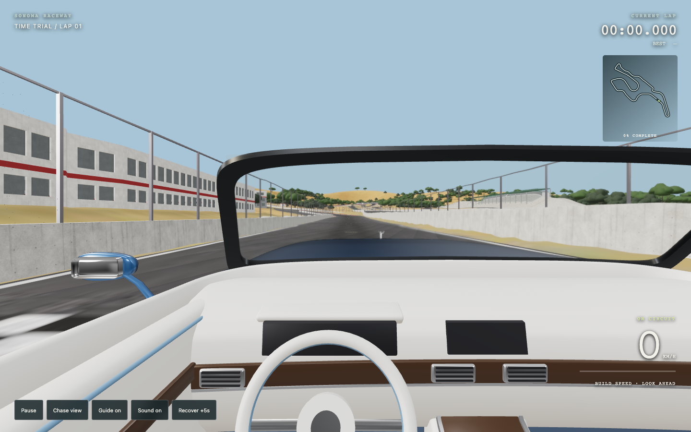
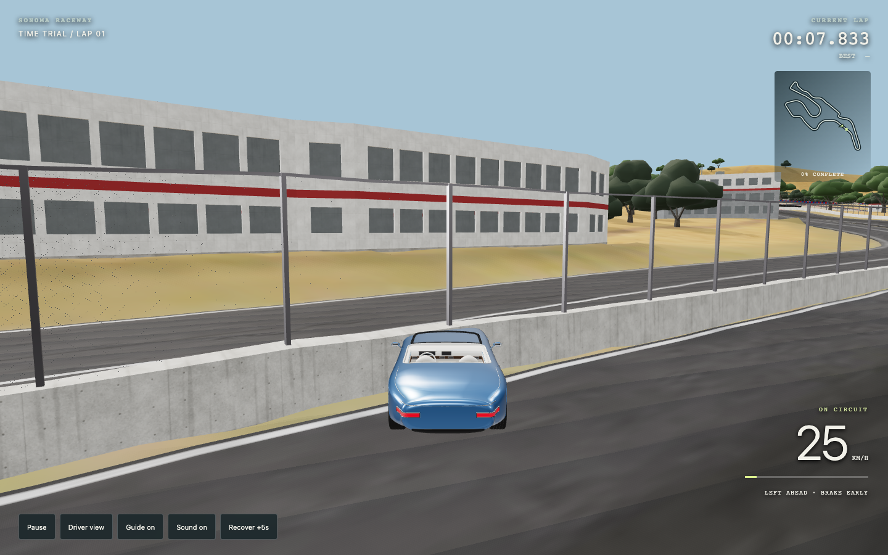
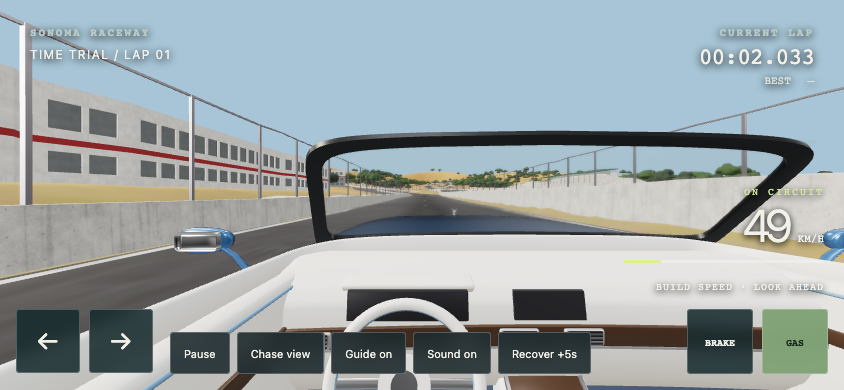
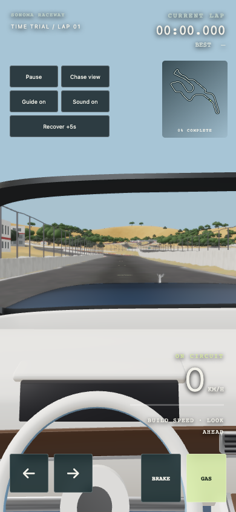

# Sonoma driving mode — verification

**Playable first-person time trial implemented and verified.** The blue open-top export is visible from the driver's seat and in chase view. No new paid generation was started.

## Files changed

- `racing/`: HTML/CSS HUD, renderer/input/audio module, simulation, sampled route, vendored Three.js modules and original blue roadster GLB.
- `tools/build_driving_route.py`: rebuilds road centers, banking, runoff and wall clearances from the unchanged track.
- `tests/racing-simulation.mjs`: full-lap, checkpoint, reset and boundary tests.
- `index.html`, `README.md`: entry link and driving instructions. Existing track GLBs are unchanged.

## Game design brief

Player promise: drive the open-top car around the existing hilly circuit from the driver's seat. Core loop: accelerate along straights, brake before corners, steer through apexes, recover from mistakes, and complete ordered gates to set a best lap. Going off road loses speed; recovery costs five seconds. Best time is local to the device. No AI opponents.

Level/encounter plan: front-straight start, uphill turns, winding hill section and hairpins, then return to the start. Straights provide recovery between tighter corners. Optional guide arrows, map and bend cues show the route. First-person is default; chase view shows the car. Grip, braking distance and road shape create the skill test.

Controls: W/A/S/D or arrows, Space brake, R recovery (+5s), C camera, Escape pause. Touch pedals and steering support phones. Start-fresh-lap and sound/guide toggles are available.

## Verification

No build toolchain is required: this is static JavaScript with vendored imports. `node --check racing/race.js`, `node --check racing/simulation.js`, `node tests/racing-simulation.mjs` and `git diff --check` passed.

- Pure simulation bot completed all 24 ordered gates and a full lap in 175.767 simulated seconds, maximum lateral error 2.40 m, no boundary contacts. Its controller uses the same public simulation step as player input; it does not teleport during the full lap. An out-of-order finish failed to record a lap, as expected.
- Boundary test starts at 50 m/s aimed sideways; car remains inside sampled clearances. Recovery stops the car and adds five seconds; fresh lap resets clock and gate state.
- Desktop Chrome at 1440×900: real keyboard input accelerated from 0 to 23.44 m/s over four seconds and moved 51.89 m. Space reduced speed, steering changed heading and lateral position, C changed camera, Escape paused, resume and R worked. No console/page errors or failed network requests in the ordinary run.
- Mobile Chrome emulation at 844×390 and 390×844: pointer-held throttle increased speed, release outside the pedal cleared input, pause froze time, fresh lap reset time/speed. All four touch targets fit within the portrait viewport, at least 64×64 CSS px. No horizontal page overflow. Sound toggle changed the enabled state. No page errors or failed network requests.
- Injected missing-car 404 displayed a readable load error and kept Start disabled.
- Desktop and mobile screenshot/canvas pixel checks are nonblank. Central crop RGB standard deviations exceed 43 for all four active views. These are screenshot pixel checks plus inspection, not a GPU benchmark.

Physics engine: a custom arcade bicycle and shared surface sampler, with timestep 1/120 second; one canonical car state. Collider strategy: sampled left/right wall clearances minus 1.2 m car clearance, plus bounded runoff corridor; 24 ordered progress sensors. No rigid bodies, no physics-package colliders, no CCD engine flag; maximum step is under 0.61 m at top speed. The hard corridor resolves every step, rather than testing only per rendered frame. Suspension, jumps and rigid-body impacts are not simulated.

## Performance evidence and assets

The existing scene needed about 7,090 draw calls at the initial driver pose before static batching. Repeated meshes were instanced in 250 m cells; the same initial pose dropped to about 1,024 calls. The final camera measures about 1,030 calls / 4.60 million drawn triangles on desktop and 1,062 calls / 4.76 million triangles on mobile emulation. Batching trades finer individual culling for far fewer calls. Desktop reports 444 geometries / 49 textures; mobile 380 / 47. Headless frame timings are functional evidence only, not real-device FPS or a performance guarantee.

The car is the existing user provided asset `racing/assets/blue-roadster.glb`, 13,459,744 bytes, SHA-256 `339d95cc93936a32cc397fbd65b1050a049ac573cd2c67cea4f1e977afc491c0`. It retains its existing body/interior and four wheel pivots. The reused compressed track is about 12.4 MB. No car generation was substituted; local provenance is retained.

Audio uses gesture-unlocked Web Audio oscillators and a low-pass filter tied to speed/throttle, with mute and pause gating. Toggle behavior was tested; human listening and audio capture were not performed.

Visual test harness: captured and inspected current driver/chase/portrait/landscape screenshots; no cross-machine pixel baseline is asserted because WebGL output varies. Bot playtest: added a deterministic full-route driving controller plus real-input browser smoke tests. The driving code does not contain a player-facing autopilot.

## Remaining risks

Arcade handling and sampled corridor collisions are approximate; not a vehicle dynamics simulator. The old model's visual defects remain. Mobile checks use emulation, not physical phone hardware. A heavy imported track and car still draw several million triangles; older GPUs may struggle. Engine audio is synthesized, not a recorded engine. No online multiplayer, opponents, reverse gear or alternate-route lap logic. Storage restrictions may prevent persistence of the best time. WebGL failure explains the requirement to the user but was not forced in the browser tests.

GitHub Pages is currently disabled on the repository; this account has push access but no repository-admin permission. The mode is runnable locally and committed source can be hosted as a static site by a repository admin. Local play URL: `http://127.0.0.1:8882/racing/`.

