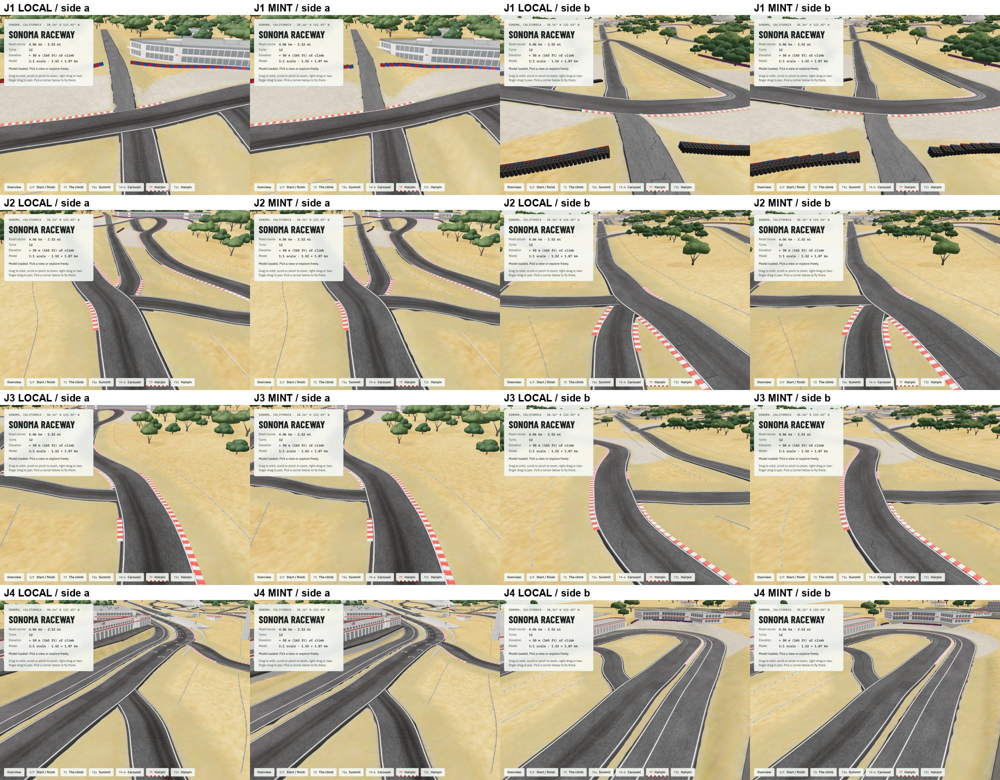
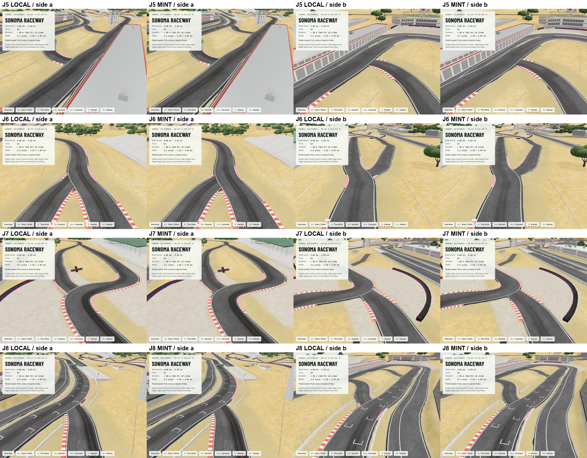
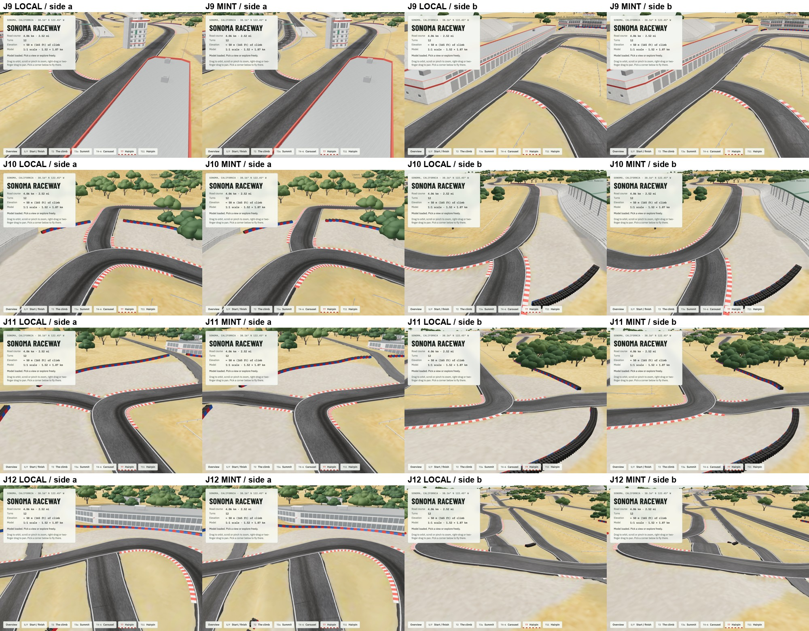
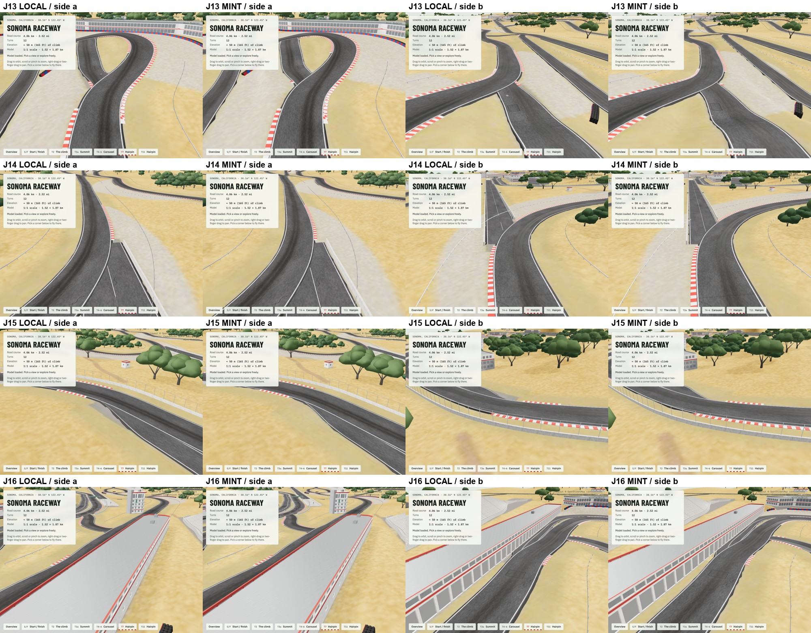

# Second Mint revision review — October 21, 2026

**Decision: retain the locally repaired model and existing web viewer.** The new revision improves many heights relative to the original, but does not improve overall junction continuity relative to the repair already published.

The existing operation completed at 5:46 PM Pacific. No new generation was started. Its 52,903,888-byte GLB differs from both the original and the published repair.

## Reproducible measurements

The same committed `tools/check_junctions.py` was run against both full-quality models, in the same Python environment. It uses a 10 cm horizontal gap tolerance, 5 cm upward-step tolerance and allows up to 15 cm of tuck beneath `road_main`.

| Measurement | Published local repair | Second Mint revision |
| --- | ---: | ---: |
| Joined road ends measured | 18 | 18 |
| Ends passing the checker | 17 | 1 |
| Ends flagged by the checker | 1 | 17 |
| Free ends | 2 | 2 |

The checker includes every vertex in each detected road-end cap, so a flagged edge gap does not mean the whole road is disconnected. The new export introduces more split/end vertices. Counts should therefore be read with the geometric measurements and renders, not as a visual score.

The local repair's one flagged end is the drag-strip join: one end-cap vertex remains 3.90 m outside `road_main` while four overlap it at a 10 cm tuck. This is a retained corner on the verge, already listed among the known issues. The previous README claim that all 18 ends passed was too broad and is corrected.

The new revision retains that 3.90 m drag-strip gap and adds flagged end-cap gaps of 0.19–1.97 m elsewhere. Two fully overlapping ends also sit too deep: the inner Turn 10 branch reaches a 31.7 cm tuck and the pit-lane start reaches a 36.5 cm tuck, beyond the requested 3 cm and 10 cm limits. These measurements do not satisfy the revision brief.

## Visual review and preservation

Rendered all 16 numbered junctions from two opposing oblique cameras for each model: 64 images total. The four comparison sheets below show LOCAL and MINT at identical camera positions, with both sides of each junction.

- The large floating slabs and cliffs are gone in both versions. The candidate is substantially better than the original export.
- The access road still has ragged edges, so the requested clean ribbon rebuild is incomplete.
- Some road-edge mouths remain short of the circuit edge, consistent with the numerical checks. Kerbs still run across several mouths.
- The grey-blue terrain patch beside the pit-lane start is less apparent in the new export, a partial improvement; the deeper pit-lane end tuck remains a failed target.
- Removing the duplicate `road_alt_t7_link` is confirmed in the candidate.
- Main-circuit unique vertex positions match the original to 0.1 mm and its triangle count is unchanged. The same position-set and face-count checks passed for all 163 protected geometry entries selected by `road_main`, `buildings_`, `bld_`, and `grandstands_` naming. This is not a blanket assertion that every UV, normal or material field is byte-identical: re-export changed vertex splitting and some floating-point serialization.
- Both models loaded and rendered in headless Chrome. No page exceptions were recorded; one resource 404 was recorded, and its URL was not captured. Responsive UI and other viewer behavior were not re-audited because no viewer code or published model changed.

The remaining A–F requirements are not certified complete. In particular, exposed sides, smooth blends, kerb ends and the drag-strip dead-end details still require further work before claiming the entire revision brief is satisfied. No further paid revision was submitted.

## Evidence

- [Published repair measurements](local-junction-check.json)
- [New revision measurements](mint-v3-junction-check.json)
- [Selected geometry comparison](geometry-comparison.json)
- [Protected position checks](protected-position-check.json)

## File fingerprints (SHA-256)

- Original: `e033e46f21f04a3bdfd9ac8687c9770feeb6fcb83ccd7a97799606d43c6a0330`
- Published repair: `ecf3400b878b90f020a5c6a49d570dafd79fe2c6e29c485dc815ccf8e069a6a4`
- Second Mint revision: `594aed5c744562a3dd41b63d1dd6ee68aac9cdcbd00fd0688c404aec686302dd`

The candidate stays in the local ignored `build/` directory for future work. The existing full and web models remain the published versions.
