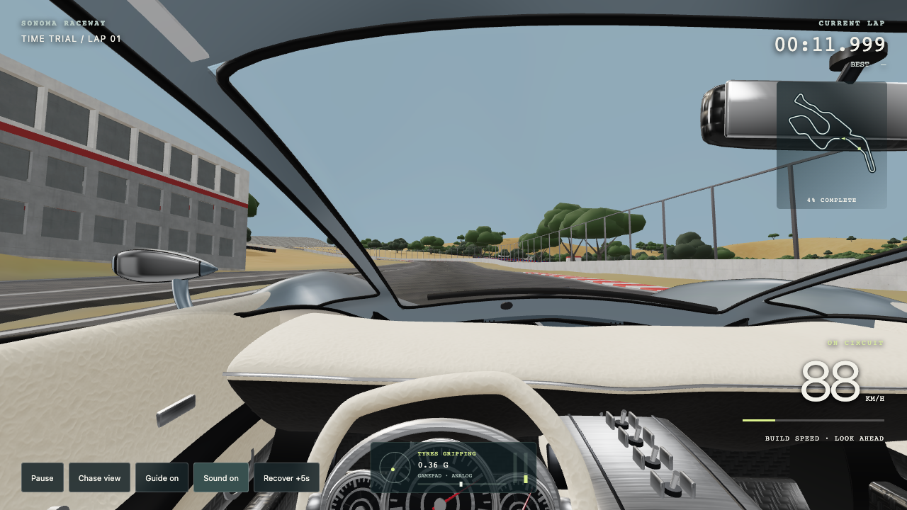
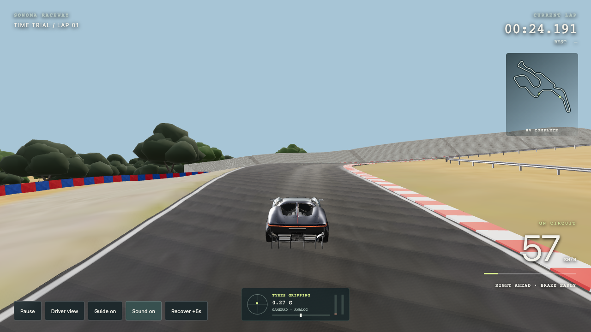

# Steering and feedback revision — October 28, 2026

Target: approachable circuit racing in the direction of Gran Turismo / Forza Motorsport, as requested by the player. Brake before the bend, turn in progressively, balance the pedals at the grip limit, unwind the wheel and accelerate out. Ordered lap checkpoints, penalties and recovery remain the time-trial loop. Going too fast now pushes the nose wide; steering harder cannot create unlimited grip. The HUD and tyre audio explain the loss of grip so the next attempt can improve.

## What changed

Previously the game calculated yaw directly from speed and steering, clamped yaw to a grip limit, and always translated along the car's heading. There was no lateral velocity or yaw inertia. Steering now commands a rack angle; front/rear tyre forces integrate lateral velocity and yaw momentum at 120 Hz. Body direction and travel direction can differ.

`racing/handling.js` owns the dynamic single-track chassis. Slip-angle forces saturate progressively, braking and cornering share grip, and estimated longitudinal/lateral weight transfer alters four contact load/grip budgets. Tyres crossing the asphalt edge lose grip progressively. A bounded stability-control yaw moment approximates selective braking, helping catch rear instability without teleporting the car's orientation. The low-speed solver blends to parking kinematics below 6 m/s and is fully kinematic below 3 m/s. This avoids stiffness near a standstill. Wall contact removes the outward velocity component and damps yaw, replacing the old arbitrary heading snap and 30% speed cut.

The method follows the body-velocity/yaw and tyre-slip relationships described in [MathWorks' vehicle-dynamics example](https://www.mathworks.com/help/ident/ug/modeling-a-vehicle-dynamics-system.html). This implementation is original game code with a bounded nonlinear tyre approximation, not that example's linear solver. [The single-track model reference](https://www.mathworks.com/help/driving/ref/bicyclemodel.html) describes the scope of this model family.

The custom planar solver remains appropriate for this surface-following time trial: one chassis, a shared smooth height sampler, and a bounded route corridor. No rigid-body engine, WASM dependency or detailed visual-mesh collider was added. Full four-wheel suspension, airborne motion and impact deformation require a different physics architecture. The four contact budgets are load/grip estimates feeding two axle forces; they are not independently simulated wheel rigid bodies.

## Controls and feedback

- Keyboard steering builds at a bounded rack rate, returns more quickly, and counters more quickly still. Speed-sensitive steering reduces full-key travel at speed. There is no automatic path following in normal gameplay.
- A standard gamepad gives analog left-stick steering with a 7% deadzone and progressive curve. RT accelerates; LT brakes; Y changes camera, B recovers, and Menu pauses. Disconnect returns the analog intent to zero.
- Touch steering uses a draggable analog pad. Release, cancellation, focus loss and pause clear it. Pedals retain independent pointer capture.
- **Speed-sensitive steering** can be disabled for direct full-lock input. Stability control remains enabled in both modes. Steering lock and handwheel ratios are plausible estimates, not measured specifications for these particular cars.
- Wheel rolling and Ackermann front-wheel angles are animated. The Tourbillon rim rotates while its instrument hub remains fixed; the Porsche handwheel rotates about its own centre.
- Damped pitch/roll, fixed-step pose interpolation, subtle load-related head movement and modest speed FOV communicate weight and speed. **Camera motion** disables the added head/FOV effects; reduced-motion preference is respected on a new device. Chassis and road attitude remain visible.
- Live pedal bars, rack position, a G-force dot, and front/rear grip status make the physical state readable. **Sound on** adds deterministic tyre scrub/road noise to the existing synthesized engine. Optional supported gamepad rumble responds to slip, runoff and impacts. It is vibration, not a wheel's force-feedback torque.

New lap records use `sonoma.best.v3.*`; older local records are retained but not mixed with the new handling. Car assets and the smoothed track geometry are unchanged.

## Iteration and verification

Initial tyre-force testing exposed difficult rear instability while braking, so a bounded yaw stability moment was added and tuned. A parking-radius test then caught an inaccurate low-speed blend, which was corrected. A full left–right input reversal starting at 60 m/s exposed excessive sustained sideslip. Adding sideslip feedback to the bounded stability moment reduced peak lateral velocity from 18.79 to 6.08 m/s for the Tourbillon in that stress case; all three settle after release/braking. This is a synthetic robustness test, not an ISO lane-change certification. The old bot assumed immediate heading response and binary pedals; the revised conservative bot uses sideslip/yaw feedback and analog pedals. Its lower pace is deliberate QA control, not a lap-time regression measurement.

`node tests/handling-dynamics.mjs` verifies, for all three cars: turn-in inertia, release settling, countersteering, parking radius, standstill behavior, grip saturation/understeer, high-speed perturbation recovery, braking in a turn, progressive wheel-off grip, steering limits/rates, Ackermann symmetry and integration agreement at 120/240 Hz. It also verifies gamepad shaping/deadzone/disconnect defaults and runs straight-line acceleration/braking through the full chassis.

At 20 m/s with 0.035 rad wheel angle, steady lateral acceleration is 4.35 m/s² (Tourbillon), 4.72 (Porsche), and 3.50 (roadster). Releasing the wheel settles yaw rate below .01 rad/s and side velocity below .05 m/s within the two-second check. These are repeatability/stability checks, not measured real-car validation. The previously calibrated straight-line acceleration and Porsche braking benchmarks remain intact.

All three cars finish full conservative laps without boundary contacts, with maximum centreline deviation under 2.5 m (asphalt half-width 6.5 m). The bot bounds now allow 3.5 m to account for dynamic rather than instantaneous steering. Checkpoint, recovery, reset and high-speed corridor tests pass. Reports: `dynamics.json`, `full-laps.json`, `lap-reset-boundaries.json`, `performance-regression.json`.

Chrome checks used actual keyboard and pointer input, plus a virtual standard gamepad to exercise analog triggers, steering, camera/pause buttons and disconnect handling. All three models switched successfully. Portrait and landscape had no horizontal overflow; touch drag/release worked. A 24-second recorded analog-control run covered approximately 451 m, including the uphill bends, with zero contacts and no page errors. The controller was a conservative automated driver feeding the same standard-gamepad input path; the recording is actual gameplay, not hand-animated motion. Screenshots and JSON accompany this review; the video is silent. Physical gamepad feel/rumble and phone GPU performance were not tested on hardware.

## Gameplay capture

[Watch the current 24-second handling clip](../../media/gameplay/sonoma-handling.mp4).

## Limits

This is a substantial handling iteration toward the requested feel, not a claim of AAA parity or a validated model of the exact cars. Mass distribution, tyre stiffness/load sensitivity, yaw inertia, suspension-feel constants, steering ratios and stability controller are estimates. There is no proprietary tyre test data, full drivetrain, individual suspension/contact dynamics, wet-weather model, temperature/wear model, calibrated kerb impacts or wheel force-feedback driver. Earlier manufacturer acceleration calibration does not validate these lateral dynamics. See the [performance calibration](../tourbillon-review/README.md) for original published figures and estimated parameters.
